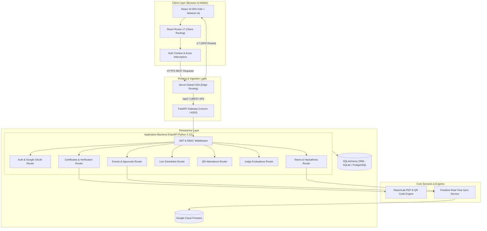
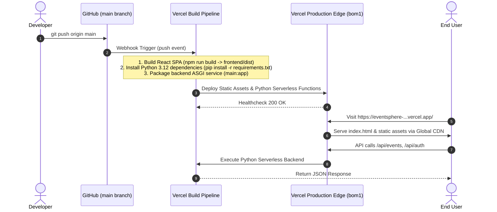

# EventSphere (Occasio) — Intelligent Multi-University Event Management Platform

[](https://fastapi.tiangolo.com)
[](https://react.dev)
[](https://vitejs.dev)
[](https://www.python.org)
[](https://eventsphere-vankireddis2023-vitstudentas-projects.vercel.app)
[](backend/tests)

EventSphere is an intelligent, full-stack multi-university event management and discovery platform. It streamlines event proposals, approvals, schedule tracking, team registrations, live attendance via QR codes, judge evaluations, and automated certificate generation.

---

## ??? System Architecture

EventSphere employs a decoupled modern architecture combining a reactive client Single-Page Application (SPA) with a high-throughput asynchronous Python FastAPI backend, supported by dual-layer persistence (SQLAlchemy relational database with Google Cloud Firestore synchronization).



---

## ?? GitHub & Deployment Workflow



---

## ?? Core Subsystems

| Module | Purpose | Key Endpoints |
|---|---|---|
| **Auth & Profiles** | JWT access tokens, role-based access control, Google SSO | `/api/auth/login`, `/api/auth/google`, `/api/auth/me` |
| **Events Management** | Proposal submissions, admin approvals, categories, filtering | `/api/events`, `/api/events/{id}/approve` |
| **Teams & Hackathons** | Team formation, invite codes, member rosters, event binding | `/api/teams`, `/api/teams/join` |
| **Attendance & QR** | Dynamic QR code generation, check-in scanning, attendance tracking | `/api/attendance/check-in`, `/api/attendance/event/{id}` |
| **Judge Evaluations** | Rubric scoring, multi-criteria evaluations, live leaderboards | `/api/judges/scores`, `/api/leaderboard/{id}` |
| **Certificates** | Cryptographic PDF certificates with embedded QR verification | `/api/certificates/generate`, `/api/certificates/verify/{id}` |
| **Live Monitoring** | Real-time participant counts, engagement analytics | `/api/monitoring/events/{id}` |

---

## ?? Local Development (Single-Host Unified Server)

Run both the frontend and backend together on a single port (`http://localhost:8000`):

```bash
# 1. Install dependencies
cd backend && pip install -r requirements.txt
cd ../frontend && npm install && npm run build
cd ..

# 2. Launch unified server
python run.py
# (Or simply double-click start.bat on Windows)
```

The unified server automatically serves:
* **Web UI**: `http://localhost:8000`
* **Teams Page**: `http://localhost:8000/teams`
* **API Endpoints**: `http://localhost:8000/api`
* **Interactive Docs**: `http://localhost:8000/docs`

---

## ?? Testing Suite
Execute the full test suite (29 tests covering authentication, event lifecycles, and scheduling):
```bash
python -m pytest backend/tests/
```
