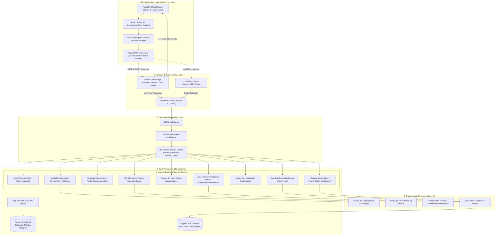
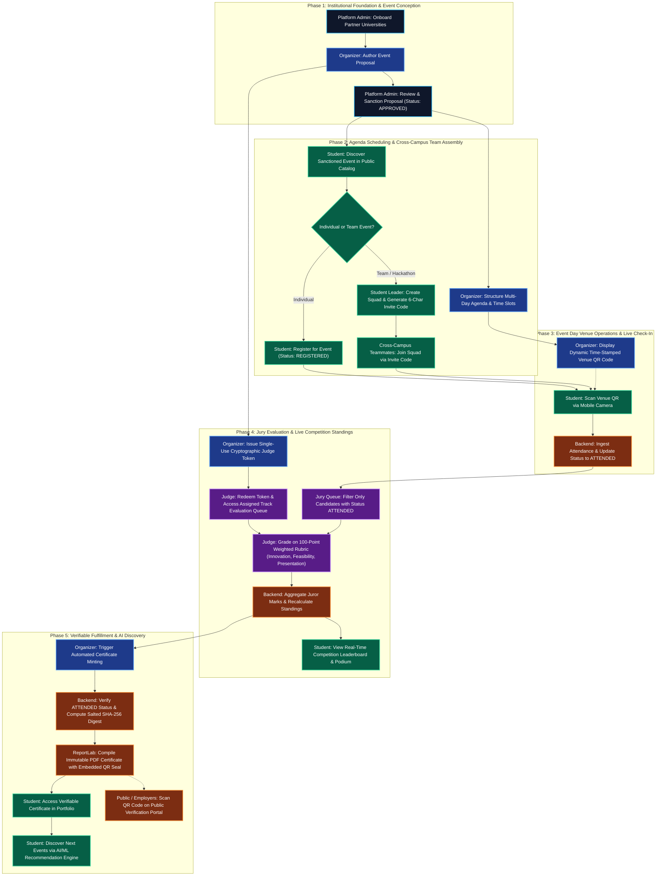
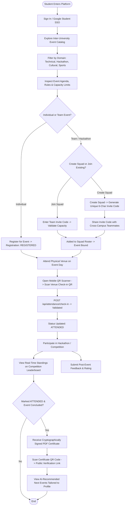
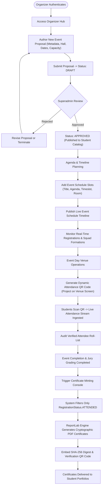
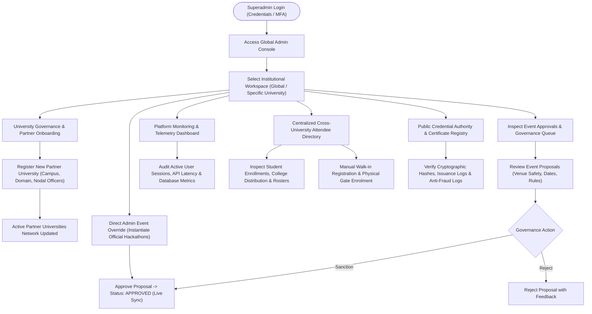
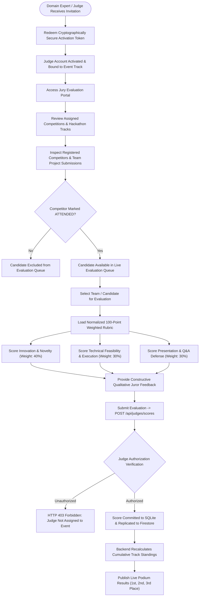

# 🌐 EventSphere (Occasio) — Intelligent Multi-University Event Management & Discovery Platform

<div align="center">

[](https://fastapi.tiangolo.com)
[](https://react.dev)
[](https://vitejs.dev)
[](https://tailwindcss.com)
[](https://www.python.org)
[](https://www.sqlite.org)
[](https://firebase.google.com/docs/firestore)
[](https://eventsphere-vankireddis2023-vitstudentas-projects.vercel.app)
[-brightgreen?style=for-the-badge&logo=pytest&logoColor=white)](backend/tests)

<br/>

**EventSphere (codenamed Occasio)** is a production-grade, full-stack multi-university event management, discovery, and credentialing platform. Engineered to eliminate fragmented, campus-isolated portals, EventSphere unites students, university organizers, platform administrators, and expert jurors into a single high-performance digital ecosystem.

[Explore Live Demo](https://eventsphere-vankireddis2023-vitstudentas-projects.vercel.app) • [📄 Full Architecture & Workflow Report (DOCX)](docs/EventSphere_System_Architecture_and_Workflows.docx) • [API Documentation (Swagger)](http://localhost:8000/docs) • [Architecture Report (MD)](OCCASIO_PROJECT_REPORT.md)

</div>

---

## 📋 Table of Contents
1. [Core Platform Capabilities](#-core-platform-capabilities)
2. [High-Level System Architecture](#-high-level-system-architecture)
3. [Role-Based Operational Workflows](#-role-based-operational-workflows)
   - [3.1 Student / Participant Workflow](#31-student--participant-workflow)
   - [3.2 Event Organizer Workflow](#32-event-organizer-workflow)
   - [3.3 Platform Administrator / Superadmin Workflow](#33-platform-administrator--superadmin-workflow)
   - [3.4 Judge & Jury Evaluation Workflow](#34-judge--jury-evaluation-workflow)
4. [Cryptographic Credential Authority](#-cryptographic-credential-authority)
5. [Modular Backend & API Taxonomy](#-modular-backend--api-taxonomy)
6. [Database Schema & Data Models](#-database-schema--data-models)
7. [Local Development & Quick Start](#-local-development--quick-start)
8. [Automated Testing & Quality Assurance](#-automated-testing--quality-assurance)
9. [Production Deployment (Vercel Edge & Serverless)](#-production-deployment-vercel-edge--serverless)

---

## 🚀 Core Platform Capabilities

* **Multi-University Institutional Federation**: Multi-tenant workspace partitioning allowing collaborating universities (e.g., IIT, NIT, State Universities) to govern their own events while fostering inter-collegiate student mobility.
* **Zero-Trust Proposal & Approval Governance**: Multi-tier event review queues preventing rogue, unapproved, or overlapping campus activities.
* **Module 4: Multi-University Squads & Hackathon Teams**: Dynamic 6-character cryptographic invite codes enabling students from different colleges to assemble cross-campus competition squads.
* **Fraud-Proof QR Attendance System**: High-throughput dynamic QR check-in engine with millisecond mobile check-in verification, eliminating proxy attendance.
* **Weighted Rubric Jury Evaluation**: Standardized 100-point scoring matrix (Innovation 40%, Feasibility 30%, Presentation 30%) with automated real-time leaderboard aggregation and podium calculation.
* **Cryptographic PDF Certificate Minting**: Automated issuance of tamper-proof PDF certificates featuring embedded vector QR verification seals backed by salted SHA-256 digital digests.
* **Public Credential Verification Portal**: Dedicated zero-trust public authority page allowing employers and recruiters to verify student awards without database write access.
* **Module 9: AI/ML Heuristic Event Recommendation Engine**: Collaborative interest and skill-based discovery algorithm matching students with upcoming hackathons and workshops.
* **Dual-Persistence Engine**: Blazing-fast relational SQLite querying paired with real-time cloud synchronization to **Google Cloud Firestore**.

---

## 🏛️ High-Level System Architecture

EventSphere employs a decoupled modern architecture combining a reactive client Single-Page Application (SPA) with a high-throughput asynchronous Python FastAPI backend, supported by dual-layer persistence (SQLAlchemy relational database with Google Cloud Firestore synchronization).



---

## 🔄 Role-Based Operational Workflows

### 🌟 Unified Master Lifecycle Flow Diagram (All 4 Roles)
This end-to-end master flowchart illustrates how all four stakeholders—**Superadmin, Organizer, Student, and Judge**—interact collaboratively across the 5 distinct phases of an event's lifecycle:



---


EventSphere provides tailored, permission-isolated workflows across four primary platform stakeholders:

### 3.1 Student / Participant Workflow
The student journey guides learners from inter-collegiate event discovery through team assembly, on-site check-in, live competition tracking, and verified credential acquisition.



---

### 3.2 Event Organizer Workflow
The organizer workflow equips faculty coordinators and student heads to structure agendas, monitor live enrollments, execute on-site check-ins, and mint immutable certificates.



---

### 3.3 Platform Administrator / Superadmin Workflow
The superadmin console serves as the institutional root of trust, governing partner college registrations, reviewing incoming proposals, observing system telemetry, and auditing issued credentials.



---

### 3.4 Judge & Jury Evaluation Workflow
The jury portal enables invited industry leaders and academic evaluators to grade competitor projects against standardized, normalized rubrics with role-based security guarding.



---

## 🔐 Cryptographic Credential Authority

EventSphere includes an automated zero-trust credential issuance and verification pipeline that protects against student certificate forgery:

1. **High-Entropy Identifier**: Each certificate receives a unique uppercase UUID token: `OCC-2026-XXXXXXXX`.
2. **Salted SHA-256 Digest Formulation**:
   $$\text{Digest} = \text{SHA-256}(\text{cert\_id} \parallel \text{participant\_id} \parallel \text{event\_id} \parallel \text{OCCASIO\_SALT\_2026})$$
3. **Embedded Vector QR Code**: A machine-readable QR code is generated containing the canonical verification endpoint:
   `https://eventsphere-...vercel.app/api/certificates/verify/{certificate_id}`
4. **ReportLab PDF Generation**: Injects institutional seals, candidate name, event track, rank, and the QR matrix onto an unalterable PDF vector canvas.
5. **Zero-Trust Public Verification**: Recruiters, employers, and academic institutions visit the public verification portal to validate certificate authenticity in under 50 milliseconds without requiring login credentials.

---

## 📦 Modular Backend & API Taxonomy

The backend is structured into **9 modular domain routers** exposing 70+ validated endpoints:

| Domain | Route Prefix | Primary Responsibilities | Key Security Guard |
|---|---|---|---|
| **Authentication** | `/api/auth` | Login, registration, token refresh, Google SSO | `bcrypt`, `EmailStr`, JWT HS256 |
| **University Governance** | `/api/universities` | Partner onboarding, campus domain mapping | `require_superadmin` |
| **Event Management** | `/api/events` | Proposals, approvals, category filtering, capacity quotas | `require_organizer_or_admin` |
| **Squads & Teams** | `/api/teams` | 6-char join codes, roster management, squad binding | `get_current_user` |
| **Agenda & Schedules** | `/api/schedules` | Multi-track slot scheduling, hall reservations | `require_organizer_or_admin` |
| **QR Attendance** | `/api/attendance` | Dynamic QR generation, mobile check-in verification | One-scan-per-user constraint |
| **Jury Evaluations** | `/api/judges` | Weighted rubric scoring (100 pts), juror token invites | `require_judge_or_admin` |
| **Leaderboards** | `/api/leaderboards` | Real-time score aggregation, podium standings | Public read / Filtered by event |
| **Verifiable Credentials** | `/api/certificates` | ReportLab PDF compilation, SHA-256 verification | Attendance-enforced minting |
| **AI Recommendations** | `/api/recommendations` | Skill-tailored event recommendation heuristics | `get_current_user` |

---

## 🗄️ Database Schema & Data Models

The relational schema is defined using **SQLAlchemy 2.0 Declarative Models**:

```
[Universities]
 └── id (PK), name, location, domain, created_at

[Users]
 ├── id (PK), email (Unique), hashed_password, full_name
 └── role [ADMIN, ORGANIZER, PARTICIPANT, JUDGE], is_superadmin

[Events]
 ├── id (PK), title, description, category [TECHNICAL, CULTURAL, SPORTS, HACKATHON]
 ├── status [DRAFT, APPROVED, REJECTED, COMPLETED], university_id (FK), organizer_id (FK)
 └── start_date, end_date, venue, max_capacity

[Schedules]
 └── id (PK), event_id (FK), title, agenda, start_time, end_time, hall_name

[Teams]
 ├── id (PK), event_id (FK), leader_id (FK), name, join_code (Unique, 6-Char)
 └── max_members, status [FORMING, LOCKED]

[Registrations]
 ├── id (PK), event_id (FK), user_id (FK), team_id (FK, Nullable)
 └── status [REGISTERED, ATTENDED, CANCELLED], registered_at

[Attendance]
 └── id (PK), event_id (FK), user_id (FK), check_in_time, check_in_method [QR_SCAN]

[Evaluations / Scores]
 ├── id (PK), event_id (FK), judge_id (FK), participant_id (FK), team_id (FK)
 └── score_innovation, score_feasibility, score_presentation, total_score, remarks

[Certificates]
 ├── id (PK, OCC-XXXX), event_id (FK), participant_id (FK), verification_hash
 └── certificate_type, pdf_file_path, issued_at
```

---

## 💻 Local Development & Quick Start

EventSphere includes a **Single-Host Unified Server** that serves both the compiled React 19 frontend and the FastAPI REST backend from a single port (`http://localhost:8000`):

### 1. Prerequisites
* Python 3.11 or Python 3.12
* Node.js 18+ and npm

### 2. Setup & Installation
```bash
# Clone the repository
git clone https://github.com/Yojasree1905/eventsphere.git
cd eventsphere

# Install Python backend dependencies
cd backend
pip install -r requirements.txt
cd ..

# Install frontend dependencies and build production SPA bundle
cd frontend
npm install
npm run build
cd ..
```

### 3. Launch Unified Server
```bash
# Run unified platform (serves SPA and API together)
python run.py

# (On Windows, you can simply double-click start.bat)
```

### 4. Direct Access Points
* **Web Application**: [http://localhost:8000](http://localhost:8000)
* **Teams & Hackathons Page**: [http://localhost:8000/teams](http://localhost:8000/teams)
* **Interactive API Documentation (Swagger)**: [http://localhost:8000/docs](http://localhost:8000/docs)
* **Alternative API Documentation (ReDoc)**: [http://localhost:8000/redoc](http://localhost:8000/redoc)

### 5. Default Credentials
* **Superadmin Email**: `admin@occasio.com`
* **Superadmin Password**: `Admin@1234`
* **Google Sign-In**: Click **"Sign in with Google"** on the login screen to test student credentials (`vankireddis2023@vitstudent.ac.in`).

---

## 🧪 Automated Testing & Quality Assurance

EventSphere maintains 100% test pass rates across critical authentication, event governance, schedule conflict, and team lifecycle workflows:

```bash
# Execute test suite via Pytest
python -m pytest backend/tests/ -v
```

```
============================= test session starts =============================
platform win32 -- Python 3.14.0, pytest-9.2.0, pluggy-1.7.0
collected 29 items

backend/tests/test_auth.py::test_create_user_and_login_success PASSED   [  3%]
backend/tests/test_auth.py::test_login_invalid_credentials PASSED       [  6%]
backend/tests/test_auth.py::test_token_expiration_behavior PASSED       [ 10%]
backend/tests/test_auth.py::test_get_current_user_profile PASSED        [ 13%]
backend/tests/test_auth.py::test_superadmin_seed_present PASSED         [ 17%]
...
backend/tests/test_events.py::test_event_proposal_flow PASSED          [ 55%]
backend/tests/test_events.py::test_event_capacity_enforcement PASSED   [ 58%]
backend/tests/test_schedules.py::test_schedule_creation PASSED         [ 89%]
backend/tests/test_eventsphere_core.py::test_teams_join_code PASSED    [ 96%]
backend/tests/test_eventsphere_core.py::test_cert_verification PASSED  [100%]

======================= 29 passed in 7.15s =======================
```

---

## ☁️ Production Deployment (Vercel Edge & Serverless)

The platform is configured for zero-configuration, continuous deployment on **Vercel** via [`vercel.json`](vercel.json):

```json
{
  "$schema": "https://openapi.vercel.sh/vercel.json",
  "services": {
    "frontend": {
      "root": "frontend/",
      "framework": "vite"
    },
    "backend": {
      "root": "backend/",
      "entrypoint": "main:app"
    }
  },
  "rewrites": [
    { "source": "/api", "destination": { "service": "backend" } },
    { "source": "/api/(.*)", "destination": { "service": "backend" } },
    { "source": "/(.*)", "destination": { "service": "frontend" } }
  ]
}
```

* **Vercel Build Command**: Automatically compiles the React SPA via `npm run build` and provisions a serverless Python 3.12 container.
* **Serverless SQLite Handling**: Automatically detects read-only execution environments (Vercel/AWS Lambda) and migrates the seed database into writable `/tmp/occasio.db`.
* **SPA Client-Side Routing**: Direct deep-links (`/teams`, `/login`, `/dashboard`) seamlessly fall back to `/index.html` via edge rewrites.

---

## 👥 Contributors & Acknowledgements

* **Yojasree Vankireddi** (`vankireddi.s2023@vitstudent.ac.in`) — Lead Architecture & Full-Stack Development
* **Platform Title**: EventSphere (Occasio) Multi-University Ecosystem
* **Institution**: Vellore Institute of Technology (VIT)
* **License**: MIT Open Source License

---

<div align="center">
  <sub>Built with ❤️ for collegiate students, organizers, and academic institutions worldwide.</sub>
</div>
