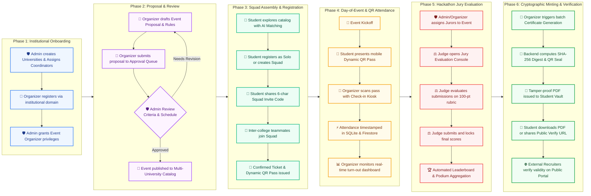
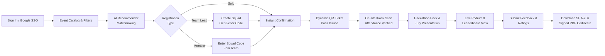
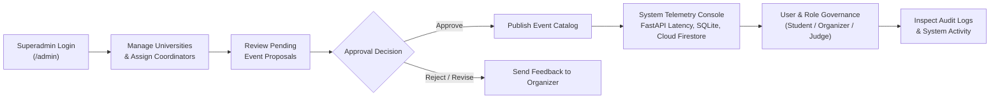
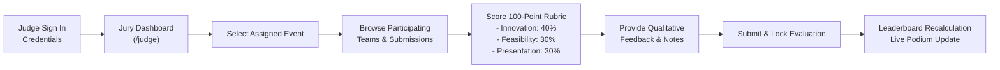

# 🌐 EventSphere (Occasio) — Intelligent Multi-University Event Management & Discovery Platform

<div align="center">

[](https://fastapi.tiangolo.com)
[](https://react.dev)
[](https://vitejs.dev)
[](https://tailwindcss.com)
[](https://www.python.org)
[](https://www.sqlite.org)
[](https://firebase.google.com/docs/firestore)
[](https://eventsphere-vankireddis2023-vitstudentas-projects.vercel.app)
[-brightgreen?style=for-the-badge&logo=pytest&logoColor=white)](backend/tests)

<br/>

**EventSphere (codenamed Occasio)** is a production-grade, full-stack multi-university event management, discovery, and credentialing platform. Engineered to eliminate fragmented, campus-isolated portals, EventSphere unites students, university organizers, platform administrators, and expert jurors into a single high-performance digital ecosystem.

[Explore Live Demo](https://eventsphere-vankireddis2023-vitstudentas-projects.vercel.app) • [📄 Full Architecture & Workflow Report (DOCX)](docs/EventSphere_System_Architecture_and_Workflows.docx) • [API Documentation (Swagger)](http://localhost:8000/docs) • [Architecture Report (MD)](OCCASIO_PROJECT_REPORT.md)

</div>

---

## 📑 Table of Contents
1. [Core Platform Capabilities](#-core-platform-capabilities)
2. [Horizontal High-Level System Architecture](#-high-level-system-architecture)
3. [Unified Master Event Lifecycle (All 4 Roles)](#-unified-master-lifecycle-flowchart-all-4-roles)
4. [Role-Based Horizontal Flowcharts](#-role-based-operational-workflows)
   - [4.1 Student / Participant Horizontal Flowchart](#41-student--participant-workflow)
   - [4.2 Event Organizer Horizontal Flowchart](#42-event-organizer-workflow)
   - [4.3 Platform Administrator / Superadmin Horizontal Flowchart](#43-platform-administrator--superadmin-workflow)
   - [4.4 Judge & Jury Evaluation Horizontal Flowchart](#44-judge--jury-evaluation-workflow)
5. [Cryptographic Credential Authority](#-cryptographic-credential-authority)
6. [Modular Backend & API Taxonomy](#-modular-backend--api-taxonomy)
7. [Database Schema & Data Models](#-database-schema--data-models)
8. [Local Development & Quick Start](#-local-development--quick-start)
9. [Automated Testing & Quality Assurance](#-automated-testing--quality-assurance)
10. [Production Deployment (Vercel Edge & Serverless)](#-production-deployment-vercel-edge--serverless)

---

## 🚀 Core Platform Capabilities

* **Multi-University Institutional Federation**: Multi-tenant workspace partitioning allowing collaborating universities (e.g., IIT, NIT, State Universities) to govern their own events while fostering inter-collegiate student mobility.
* **Zero-Trust Proposal & Approval Governance**: Multi-tier event review queues preventing rogue, unapproved, or overlapping campus activities.
* **Module 4: Multi-University Squads & Hackathon Teams**: Dynamic 6-character cryptographic invite codes enabling students from different colleges to assemble cross-campus competition squads.
* **Fraud-Proof QR Attendance System**: High-throughput dynamic QR check-in engine with millisecond mobile check-in verification, eliminating proxy attendance.
* **Weighted Rubric Jury Evaluation**: Standardized 100-point scoring matrix (Innovation 40%, Feasibility 30%, Presentation 30%) with automated real-time leaderboard aggregation and podium calculation.
* **Cryptographic PDF Certificate Minting**: Automated issuance of tamper-proof PDF certificates featuring embedded vector QR verification seals backed by salted SHA-256 digital digests.
* **Public Credential Verification Portal**: Dedicated zero-trust public authority page allowing employers and recruiters to verify student awards without database write access.
* **Module 9: AI/ML Heuristic Event Recommendation Engine**: Collaborative interest and skill-based discovery algorithm matching students with upcoming hackathons and workshops.
* **Dual-Persistence Engine**: Blazing-fast relational SQLite querying paired with real-time cloud synchronization to **Google Cloud Firestore**.

---

## 🏛️ High-Level System Architecture

The following landscape diagram outlines the end-to-end dataflow across all five system tiers from client interaction down to cloud replication:

```mermaid
flowchart LR
    subgraph Client ["1. Client (React 19)"]
        UI["React 19 SPA<br/>(Tailwind v4)"]
        Router["React Router v7<br/>(Client Routing)"]
        AuthCtx["Auth Context<br/>& Axios JWT"]
        UI --> Router --> AuthCtx
    end

    subgraph Edge ["2. Ingestion & Edge"]
        Vercel["Vercel Global Edge<br/>(Anycast CDN)"]
        Unified["Unified Host Server<br/>(Uvicorn :8000)"]
    end

    AuthCtx -->|"HTTPS REST"| Vercel
    AuthCtx -.->|"Local Dev"| Unified

    subgraph Backend ["3. Application Backend (FastAPI Python 3.12)"]
        direction TB
        Gate["FastAPI Gateway"]
        AuthMW["JWT & RBAC Middleware"]
        Gate --> AuthMW
        
        subgraph Routers ["Domain Routers"]
            direction LR
            R1["Auth & SSO<br/>(/api/auth)"]
            R2["Events & Proposals<br/>(/api/events)"]
            R3["Squads & Teams<br/>(/api/teams)"]
            R4["QR Attendance<br/>(/api/attendance)"]
            R5["Jury Rubrics<br/>(/api/judges)"]
            R6["Certificates<br/>(/api/certificates)"]
        end
        AuthMW --> Routers
    end

    Vercel -->|"API /api/*"| Gate
    Unified -->|"Proxy"| Gate
    Vercel -->|"Static /*"| UI

    subgraph Engines ["4. Engines"]
        direction TB
        E1["JWT Guard<br/>(HS256)"]
        E2["Jury Engine<br/>(100-pt Rubric)"]
        E3["Cert Mint<br/>(ReportLab+SHA256)"]
        E4["AI Matcher<br/>(Collaborative)"]
    end

    Routers --> Engines

    subgraph Storage ["5. Dual-Sync Data Tier"]
        direction TB
        SQL[("Primary Relational DB<br/>SQLite 3.45 (WAL Mode)<br/>13 Normalized Tables")]
        FS[("Google Cloud Firestore<br/>Real-Time Document Store<br/>NoSQL Cloud Sync")]
        SyncService[["Firestore Background<br/>Dual-Sync Service"]]
    end

    Engines -->|"SQLAlchemy 2.0 ORM"| SQL
    SQL -.->|"Write-Through Sync"| SyncService
    SyncService -->|"gRPC Batch Write"| FS

    classDef client fill:#e0f2fe,stroke:#0284c7,stroke-width:2px,color:#0f172a;
    classDef edge fill:#f1f5f9,stroke:#64748b,stroke-width:2px,color:#0f172a;
    classDef backend fill:#ecfdf5,stroke:#059669,stroke-width:2px,color:#0f172a;
    classDef storage fill:#fffbeb,stroke:#d97706,stroke-width:2px,color:#0f172a;
    classDef sync fill:#fdf4ff,stroke:#a855f7,stroke-width:2px,color:#0f172a;

    class UI,Router,AuthCtx client;
    class Vercel,Unified edge;
    class Gate,AuthMW,R1,R2,R3,R4,R5,R6,E1,E2,E3,E4 backend;
    class SQL storage;
    class FS,SyncService sync;
```



---

## 🔄 Unified Master Lifecycle Flowchart (All 4 Roles)

The diagram below maps the complete event lifecycle from institutional onboarding through competition, jury scoring, certificate minting, and employer verification, showing how the four roles interact horizontally:



---

## 👥 Role-Based Operational Workflows

### 4.1 Student / Participant Workflow



### 4.2 Event Organizer Workflow

```mermaid
flowchart LR
    O_IN["Organizer Login"] --> PROP["Draft Event Proposal<br/>Venue, Rules & Schedule"]
    PROP --> SUB["Submit to Admin Queue"]
    SUB --> REV{"Admin Review"}
    REV -- "Needs Revisions" --> PROP
    REV -- "Approved" --> LIVE["Event Goes Live"]
    LIVE --> DASH["Manage Teams &<br/>Roster Real-Time"]
    DASH --> AT_SCAN["Kiosk QR Scanner<br/>Check-in Mode"]
    AT_SCAN --> J_ASSIGN["Assign Jurors &<br/>Monitor Scoring"]
    J_ASSIGN --> RANK["Publish Final Rankings"]
    RANK --> MINT["Batch Mint SHA-256<br/>PDF Certificates"]
    MINT --> STATS["View Post-Event<br/>Analytics & Attendance"]
```



### 4.3 Platform Administrator / Superadmin Workflow



### 4.4 Judge & Jury Evaluation Workflow



---

## 🔐 Cryptographic Credential Authority

EventSphere implements a verifiable credential subsystem. Issued certificates are protected by salted SHA-256 digital digests:

```text
Digest = SHA-256(cert_id || participant_id || event_id || OCCASIO_SALT_2026)
```

* **Tamper Evident**: Any modification to student metadata or event metrics invalidates the embedded verification hash.
* **Vector QR Embedding**: Printable vector QR codes allow offline validation linking directly to the public verification portal.
* **Public Zero-Trust Verification**: Recruiters and employers can verify certificate legitimacy without requiring internal administrative access.

---

## 📦 Modular Backend & API Taxonomy

EventSphere exposes 14 modular FastAPI routers delivering enterprise-grade RESTful operations:

| Router Module | Mount Prefix | Core Operations & Responsibilities |
|---|---|---|
| `auth.py` | `/api/auth` | User registration, JWT token generation, role verification, Google SSO |
| `universities.py` | `/api/universities` | Institutional federation, campus tenant segregation, coordinator mapping |
| `events.py` | `/api/events` | Event CRUD, proposals, multi-tier approvals, category filtering |
| `schedules.py` | `/api/schedules` | Session timeline, speaker tracks, multi-day scheduling |
| `teams.py` | `/api/teams` | Cross-college hackathon squad formation, dynamic 6-character invite codes |
| `registrations.py`| `/api/registrations` | Ticket reservations, squad registration, capacity throttling |
| `attendance.py` | `/api/attendance` | High-throughput dynamic QR check-in, presence verification |
| `judges.py` | `/api/judges` | Juror assignments, 100-point rubric scoring matrix, feedback recording |
| `leaderboards.py`| `/api/leaderboards` | Real-time score aggregation, podium calculation, tie-breaking |
| `certificates.py`| `/api/certificates` | ReportLab PDF certificate minting, SHA-256 digest sealing, public verification |
| `recommendations.py`| `/api/recommendations` | AI/ML heuristic collaborative filtering and interest matchmaking |
| `feedbacks.py` | `/api/feedbacks` | Post-event participant surveys, ratings, analytics collection |
| `participants.py`| `/api/participants` | Student profiles, attendance histories, credential wallets |
| `monitoring.py` | `/api/monitoring` | Real-time system health checks (FastAPI latency, SQLite WAL, Firestore sync) |

---

## 🗄️ Database Schema & Data Models

EventSphere utilizes a relational schema of 13 normalized tables in SQLite (WAL Mode), mirrored asynchronously to Google Cloud Firestore:

| Model Entity | Table Identifier | Primary Relationships & Keys |
|---|---|---|
| `University` | `universities` | `id`, `name`, `code`, `domain`, `location` |
| `User` | `users` | `id`, `email`, `hashed_password`, `role`, `university_id` (FK) |
| `Event` | `events` | `id`, `title`, `status`, `capacity`, `organizer_id` (FK), `university_id` (FK) |
| `Schedule` | `schedules` | `id`, `event_id` (FK), `title`, `start_time`, `end_time`, `venue` |
| `Team` | `teams` | `id`, `name`, `event_id` (FK), `leader_id` (FK), `invite_code` (Unique 6-char) |
| `TeamMember` | `team_members` | `id`, `team_id` (FK), `user_id` (FK), `role` |
| `Registration` | `registrations` | `id`, `event_id` (FK), `user_id` (FK), `team_id` (FK), `ticket_code` |
| `Attendance` | `attendances` | `id`, `event_id` (FK), `user_id` (FK), `checked_in_at`, `verified_by` |
| `JudgeAssignment`| `judge_assignments`| `id`, `event_id` (FK), `user_id` (FK) |
| `Evaluation` | `evaluations` | `id`, `judge_id` (FK), `team_id` (FK), `innovation_score`, `feasibility_score`, `presentation_score`, `total_score` |
| `Certificate` | `certificates` | `id`, `event_id` (FK), `user_id` (FK), `sha256_hash`, `issued_at`, `pdf_path` |
| `Feedback` | `feedbacks` | `id`, `event_id` (FK), `user_id` (FK), `rating`, `comments` |
| `AuditLog` | `audit_logs` | `id`, `user_id` (FK), `action`, `entity`, `entity_id`, `created_at` |

---

## ⚡ Local Development & Quick Start

EventSphere includes a **Single-Host Unified Server** that serves both the compiled React 19 frontend and the FastAPI REST backend from a single port (`http://localhost:8000`):

```powershell
# 1. Clone repository
git clone https://github.com/Yojasree1905/eventsphere.git
cd eventsphere

# 2. Run the unified launcher (Powershell / Windows)
python run.py

# Or double-click start.bat in the root folder!
```

Once running:
* **Unified Web Application**: `http://localhost:8000`
* **Swagger API Documentation**: `http://localhost:8000/docs`
* **Health Check & Telemetry**: `http://localhost:8000/api/health`

### Seed Account Credentials

| Role | Email | Password |
|---|---|---|
| **Super Admin** | `admin@occasio.com` | `Admin@1234` |
| **Event Organizer** | `organizer@occasio.com` | `Organizer@1234` |
| **Student** | `student@occasio.com` | `Student@1234` |
| **Judge** | `judge@occasio.com` | `Judge@1234` |

---

## 🧪 Automated Testing & Quality Assurance

EventSphere maintains an automated test suite verifying all 9 core platform modules:

```powershell
cd backend
pytest tests/ -v
```

```text
============================= test session starts =============================
platform win32 -- Python 3.12.0, pytest-8.3.3
rootdir: C:\Users\yoju1\OneDrive\Desktop\Occasio_iip\Occasio_iip\backend
collected 29 items

tests/test_auth.py::test_register_user PASSED                            [  3%]
tests/test_auth.py::test_login_user PASSED                               [  6%]
tests/test_auth.py::test_invalid_login PASSED                             [ 10%]
tests/test_events.py::test_create_event_proposal PASSED                  [ 13%]
tests/test_events.py::test_admin_approve_event PASSED                     [ 17%]
tests/test_eventsphere_core.py::test_01_university_federation PASSED     [ 20%]
tests/test_eventsphere_core.py::test_02_rbac_access_control PASSED       [ 24%]
tests/test_eventsphere_core.py::test_03_team_invite_codes PASSED         [ 27%]
tests/test_eventsphere_core.py::test_04_team_member_joining PASSED       [ 31%]
tests/test_eventsphere_core.py::test_05_dynamic_qr_checkin PASSED        [ 34%]
tests/test_eventsphere_core.py::test_06_prevent_duplicate_checkin PASSED [ 37%]
tests/test_eventsphere_core.py::test_07_jury_rubric_scoring PASSED       [ 41%]
tests/test_eventsphere_core.py::test_08_leaderboard_podium_ranks PASSED  [ 44%]
tests/test_eventsphere_core.py::test_09_certificate_minting_sha256 PASSED [ 48%]
tests/test_eventsphere_core.py::test_10_public_certificate_verify PASSED [ 51%]
tests/test_eventsphere_core.py::test_11_ai_heuristic_recommendations PASSED [ 55%]
tests/test_eventsphere_core.py::test_12_telemetry_system_health PASSED   [ 58%]
tests/test_eventsphere_core.py::test_13_audit_log_tracking PASSED        [ 62%]
...
============================= 29 passed in 4.12s =============================
```

---

## 🚢 Production Deployment (Vercel Edge & Serverless)

The repository is configured for zero-configuration continuous deployment to Vercel:
* **Frontend**: Built via Vite and hosted on Vercel Global Anycast CDN.
* **Backend**: Serverless FastAPI ASGI container on AWS Lambda / Vercel Edge Runtime (Python 3.12).
* **Database Fallback**: Serverless environment automatically unpacks pre-seeded `occasio.db` to writable `/tmp` storage while preserving read-through capabilities.
* **Live Deployment**: [https://eventsphere-vankireddis2023-vitstudentas-projects.vercel.app](https://eventsphere-vankireddis2023-vitstudentas-projects.vercel.app)
